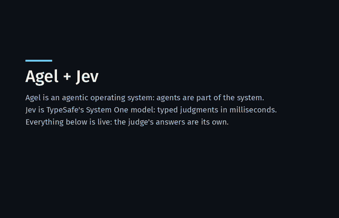
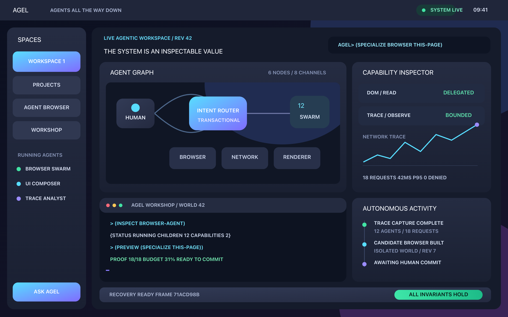

# Agel

Agel is an experimental agentic Lisp and, step by step, an operating system
in which agents are first-class values. It began as a safe hosted runtime
and keeps replacing host components with code written in Agel, on research
kernels of its own and on an unmodified seL4.

**Current release: v0.3.69.** The RuneScape example can retry a missed
mining tutor from a second tile. See the [release notes](docs/release-v0.3.69.md).

RuneScape and DOOM are example workloads. Keep game protocols, commands,
agent prompts, task definitions and scoring in the examples or their test
harnesses. The language, standard library and default OS expose shared
capabilities such as transport, inspection, replay and live versioning.
The optional legacy DOOM build still has kernel launch and display hooks.

v0.3.68 brackets each candidate replay with fixed controls.
See the [release notes](docs/release-v0.3.68.md).

v0.3.67 responds to the first observed quest dialogue page.
See the [release notes](docs/release-v0.3.67.md).

v0.3.66 verifies checkpoint gate history.
See the [release notes](docs/release-v0.3.66.md).

v0.3.65 verifies the donor’s judge journal.
See the [release notes](docs/release-v0.3.65.md).

v0.3.64 dispatches and reverts a macro-built tool in the native evaluation.
See the [release notes](docs/release-v0.3.64.md).

v0.3.63 replays the retained workload before fresh-account transfer.
See the [release notes](docs/release-v0.3.63.md).

v0.3.62 retains signed kernel versions for restaging after slot reuse.
See the [release notes](docs/release-v0.3.62.md).

v0.3.61 gates and reverts native domain launches.
See the [release notes](docs/release-v0.3.61.md).

v0.3.60 verifies the requested melee skill through XP gains.
See the [release notes](docs/release-v0.3.60.md).

v0.3.59 drives repair from the actor’s state.
See the [release notes](docs/release-v0.3.59.md).

v0.3.58 retains measured failures in the paired melee scorer.
See the [release notes](docs/release-v0.3.58.md).

v0.3.57 retries the cook interaction from adjacent tiles.
See the [release notes](docs/release-v0.3.57.md).

v0.3.56 records dialogue packets and continuation actions.
See the [release notes](docs/release-v0.3.56.md).

v0.3.55 reaches the cook dialogue from the castle entrance.
See the [release notes](docs/release-v0.3.55.md).

v0.3.54 retries an unconfirmed combat stance.
See the [release notes](docs/release-v0.3.54.md).

v0.3.53 isolates a native quest hand-in on a saved account.
See the [release notes](docs/release-v0.3.53.md).

v0.3.52 gives repair retries the judge score, threshold, and reported defect.
See the [release notes](docs/release-v0.3.52.md).

v0.3.51 keeps RuneScape client code in its example and makes DOOM opt-in.
See the [release notes](docs/release-v0.3.51.md).

v0.3.50 preserves outstanding judge receipts after the requesting process
exits. See the [release notes](docs/release-v0.3.50.md).

v0.3.49 services the game connection during replay setup.
See the [release notes](docs/release-v0.3.49.md).

v0.3.48 verifies judge receipts against the guest disk.
See the [release notes](docs/release-v0.3.48.md).

v0.3.47 adds configured HTTPS search to the standard research tools.
See the [release notes](docs/release-v0.3.47.md).

v0.3.46 shows native test milestones in the Agel OS graphical console.
See the [release notes](docs/release-v0.3.46.md).

v0.3.45 reads allowlisted HTTPS documents through the byte carrier.
See the [release notes](docs/release-v0.3.45.md).

v0.3.44 verifies the installed
Agel program and judge dispatches. See the [release notes](docs/release-v0.3.44.md).

v0.3.43 retries a missing
cook dialogue and records the pages it observes. See the [release notes](docs/release-v0.3.43.md).

v0.3.42 retains boot output and
supports a bounded deadline. See the [release notes](docs/release-v0.3.42.md).

v0.3.41 reuses the active Agel
callable across packets. See the [release notes](docs/release-v0.3.41.md).

In v0.3.40, a fresh account earned three coins by mining,
smelting and selling a bar inside Agel OS. See the [release notes](docs/release-v0.3.40.md).

v0.3.39 uses the QEMU memory map to enlarge
its x86 frame pool. See the [release notes](docs/release-v0.3.39.md).

v0.3.38 returns malformed repair proposals to the
writer with the syntax error. See the [release notes](docs/release-v0.3.38.md).

v0.3.37 smelted an adamant bar from ore and coal.
See the [release notes](docs/release-v0.3.37.md).

In v0.3.36, a fresh account reached level 2 in three
melee skills inside Agel OS. See the [release notes](docs/release-v0.3.36.md).

v0.3.35 moved byte carrier frames off the desktop terminal.
See the [release notes](docs/release-v0.3.35.md).

v0.3.34 trained Attack, Strength and Defence
on one fresh account. See the [release notes](docs/release-v0.3.34.md).

v0.3.33 added research and source inspection to the standard live-tool registry.
See the [release notes](docs/release-v0.3.33.md).

v0.3.32 trained a fresh account to Attack level 2
across ten observed encounters, with server-verified XP. See the
[release notes and evidence](docs/release-v0.3.32.md).

v0.3.31 records the [fresh-account combat comparison](docs/release-v0.3.31.md)
and the uninterrupted quest retry.

v0.3.30 first [restored a native policy and its audit history](docs/release-v0.3.30.md)
on a fresh account without new inference.

v0.3.29 adds [Agel benchmark scoring](docs/release-v0.3.29.md) and
records an uninterrupted Cook's Assistant run.

v0.3.28 first completed Cook's Assistant with ingredients earned in
ordinary gameplay. See the [quest evidence](docs/release-v0.3.28.md).

v0.3.27 verifies ground-item observations before and after a live pickup.
See the [observation evidence](docs/release-v0.3.27.md).

v0.3.26 verifies a fresh account buying a bucket with coins earned from
its first bronze-bar sale. See the [container evidence](docs/release-v0.3.26.md).

v0.3.25 verifies Cook's Assistant completion and rewards through ordinary
dialogue with staged ingredients. See the [quest evidence](docs/release-v0.3.25.md).

v0.3.24 verified the first coins from a fresh account's bronze-bar sale.
See the [economy evidence](docs/release-v0.3.24.md).

v0.3.21 forged an adamant platebody inside Agel OS with normal account rights.
See the [staged crafting evidence](docs/release-v0.3.21.md).

v0.3.20 compared fixed and adaptive native combat.
See the [paired traces](docs/release-v0.3.20.md).

v0.3.18 installed an agent-written service policy on a live connection
after text judgment and recorded replay. See the
[optimization evidence](docs/release-v0.3.18.md).

v0.3.15 added bounded source-store checkpoint recovery across reboots.
See the [release notes](docs/release-v0.3.15.md).

v0.3.14 added an Agel-written subset evaluator whose language forms can change
without recreating existing closures. See the [release notes](docs/release-v0.3.14.md).

v0.3.13 connected real model repair to native compilation and activation,
with protected judge accounting. See the [release notes](docs/release-v0.3.13.md).

v0.3.12 added Agel compilation, program-table installation, contained native
canaries, activation and revert, with retained images after reboot.
See the [release notes](docs/release-v0.3.12.md).

v0.3.11 added general model-written repairs, predictions, text judgment,
held-out replay and control evals. Run `sh scripts/test-repair.sh` or
`python3 scripts/demo-repair.py`. Connecting that model loop to native
activation and completing cost accounting remain open. RuneScape is an
application adapter, not part of these mechanisms.

v0.3.8 added live RuneScape tests that log in, walk, set one
skill and grant items through an Agel client. Agel owns RSA/XTEA/ISAAC,
packet parsing, observations, action history and the smoke-test assertions.
Run `sh scripts/test-osrs-game.sh` against the private world. Native transport,
combat/crafting/quest benchmarks and Exo comparisons remain unfinished.
See the [release notes](docs/release-v0.3.8.md) and [setup](docs/osrs-client.md).

v0.3.7 added a private revision-241 OSRS world and the first
Agel wire client: live JS5 negotiation, cache requests and login challenges.
The world runs at 1× XP with automatic admin grants disabled. Player login,
gameplay and replacing the DOOM workload remain unfinished. See the
[release notes](docs/release-v0.3.7.md) and [setup](docs/osrs-client.md).

v0.3.6 added a protected 64 MiB judge ledger with Agel
framing, torn-write recovery and result-space reservation before dispatch.
Existing bytes survive resume and interrupted appends; ordinary writers
cannot consume reserved space. See the [release notes](docs/release-v0.3.6.md)
for the tested scope and remaining guardian/client work.

v0.3.5 made Jev requests and results reach the guest's
protected log before dispatch and delivery, including retries. Agel owns
record construction and published-rate cost arithmetic. One live call's
usage and cost survived guest reboot. Existing run disks require `--resume`
or a new output directory. See the [release notes](docs/release-v0.3.5.md)
for storage limits and the unfinished guardian integration.

v0.3.4 added protected append-only OS log storage and an
Agel judge wrapper that records requests before dispatch and receipts before
returning. Overwrite, truncation, deletion and rename are refused; the log
survives reboot. See the
[release notes](docs/release-v0.3.4.md).

v0.3.3 added an evolution gate written in Agel: source diffs,
judge receipts, recorded-case replay, version retention, guarded revert and
bounded retries carrying refusal reasons. The same Lisp contract runs hosted
and inside an OS protection domain. Canonical history recovery,
actual OS service replacement and the private OSRS client remain in
the [release programme](docs/exo-programme.md). See the
[v0.3.3 release notes](docs/release-v0.3.3.md). The previous desktop tool-building
demo is documented in [v0.3.2](docs/release-v0.3.2.md). What is done, partial and open is in
[`docs/roadmap.md`](docs/roadmap.md); every release is one milestone with
honest notes, and the whole line is in [`docs/versioning.md`](docs/versioning.md).

[](docs/media/agel-agents-demo.mp4)

*The full video, 2½ minutes with Jev's live judgments under every step and the reviewer's notes: [`docs/media/agel-agents-demo.mp4`](docs/media/agel-agents-demo.mp4); the v0.2.97 film, the player alone, is [`docs/media/agel-jev-demo.mp4`](docs/media/agel-jev-demo.mp4).*

## What exists

**A language and a hosted runtime.** A small homoiconic Lisp with atomic
evaluation (a batch commits whole or not at all), versioned world state with
rollback, lexical closures, hygienic template macros, modules, conditions and
restarts, capability-scoped effects with deterministic budgets, agents with
isolated heaps and typed protocols, supervision, event history, snapshots and
replay, transactional model requests, Ed25519-signed portable images with a
tamper-evident chain, and evidence-carrying upgrades: a proposal runs in a
zero-authority canary and is promoted atomically or discarded. A standard
library, a metacircular evaluator, a UI model, a layout engine and a vector
renderer are written in Agel. See [`docs/language-core.md`](docs/language-core.md),
[`docs/agent-runtime.md`](docs/agent-runtime.md) and
[`docs/standard-library.md`](docs/standard-library.md).

**Research kernels on three machines.** Freestanding Rust kernels for
x86-64, AArch64 and RISC-V build per-domain address spaces with
write-xor-execute, a trap gate and a preemption timer, and run every world
unprivileged: the evaluator, the console driver, the disk driver (ATA,
virtio-blk, or the Raspberry Pi's SD host controller), the filesystem
service, the compositor, and loaded processes. A versioned kernel contract
with a 118-step corpus is answered byte-identically by all three and by a
second implementation on seL4 under Microkit. Worlds that write kernel
memory, run privileged instructions, touch ungranted devices or never yield
are contained; a driver that dies is replaced at a new generation and its
old handles fail closed. See [`docs/architecture.md`](docs/architecture.md),
[`docs/kernel-contract.md`](docs/kernel-contract.md) and
[`docs/threat-model.md`](docs/threat-model.md).

**A durable workshop.** The serial workshop on each machine edits named
source cells, saves them to alternating checksummed disk slots, replays them
after reboot, survives a power cut at any write, and on x86-64 selects
between A/B kernel slots with signed candidates and watchdog rollback. See
[`docs/native-workshop.md`](docs/native-workshop.md) and
[`docs/native-boot.md`](docs/native-boot.md).

**A desktop.** At 1920×1080, styled with COSMIC's palette, radii and
spacing: anti-aliased Fira Sans and Fira Mono from font atlases on the disk,
surfaces with soft shadows and edges, a panel with a launcher and a clock, a
dock, hover and press states, a terminal panel, and windows that processes
ask for and draw into through records the supervisor checks before it
paints them. Windows move by their header, stack, minimize to panel pills,
maximize, resize by their corner, and hand a process its presses, keys,
motion, releases and resizes while the desktop keeps running, with
several programs running at once, each reported as it ends, and a
canvas of pixels a process draws itself, blitted into its window. The
compositor holds the framebuffer as its only device mapping; every click is
a typed command underneath. See [`docs/native-graphics.md`](docs/native-graphics.md).

**A POSIX personality.** Processes loaded from the disk into protection
domains, files through a namespace granted per process and served by an
unprivileged filesystem service, `agel-libc` (a Rust archive with a C ABI)
so C programs build from source and run, `spawn` in place of `fork`, pipes
and `wait`, a heap that grows through pages mapped at the break, a
monotonic clock, `sleep` and `kill`, `setjmp`, `scanf` and `getopt`,
`stat`, `rename`, `unlink`, directories, `chdir` and `truncate`, files of
64 KiB, large read-only files under `/data`, floating point with
`math.h`, and a window protocol for C. Authority comes from the namespace,
never from a path. See [`docs/posix-personality.md`](docs/posix-personality.md).

**A board.** The AArch64 kernel builds as a flat image for the Raspberry
Pi 4, boots on QEMU's model of it from an EL2 entry with RAM at zero,
drives the SD card, and runs the desktop with its framebuffer from the
firmware's mailbox. A Pi 5 image is built from documented addresses and has
not run yet. See [`docs/raspberry-pi.md`](docs/raspberry-pi.md).

Agel is pre-production. It does model **inference, not training**, and
takes its Linux application compatibility from the POSIX personality above
the kernel rather than from Linux underneath; scope and tiers are in
[`docs/deployment-targets.md`](docs/deployment-targets.md).

## Try it

The hosted runtime needs a Rust toolchain and a C compiler (Xcode
command-line tools on macOS; GCC or Clang on Linux):

```sh
cargo run -p agel-cli
```

The banner lists the installed Agel libraries; `--no-stdlib` exposes only
the substrate and `--image PATH` persists the world as a portable image.
Inside the REPL, `:help` lists the commands; `:propose FILE`, `:promote` and
`:discard` run the upgrade gate. A batch of forms is one transaction:

```lisp
(def answer 42) (def broken (/ answer 0))
```

The division error leaves both definitions uncommitted.

### The native desktop

The boot scripts need `qemu-system-x86_64`, `clang`, GNU `objcopy` and the
`x86_64-unknown-none` Rust target (`brew install qemu binutils` on macOS);
C programs need a clang with `lld` (`brew install llvm lld`).

```sh
./scripts/run-graphics.sh
```

QEMU opens its own window at 1920×1080 on a persistent desktop disk with the
Agel runtime and browser examples. Click the desktop to open the workbench.
`--web` adds a host-side console with layout composition and paste.
`--doom-demo` loads the legacy DOOM example. `--agent` adds that demo's
host judge using `TYPESAFEAI_API_KEY` from the environment.
`python3 scripts/record-demo.py OUT.mp4` records the video above, live. Try:

```lisp
(def square (fn (x) (* x x)))
(square 12)
:cell mathematics (def triangular (fn (n) (/ (* n (+ n 1)) 2)))
:save
(accent cyan)
(workspace 2)
:fs-format
:exec c-chart -- 3 7 5 9
:help
```

`:save` keeps cells across `:shutdown` and the next launch. Click
**Applications** for the launcher, a dock tile for its action, a window's
header to move it, its corner to resize it, its controls to minimize,
maximize or close it. Walkthroughs: [`examples/graphical-workshop.txt`](examples/graphical-workshop.txt),
[`examples/native-workbench.txt`](examples/native-workbench.txt),
[`examples/native-agents.txt`](examples/native-agents.txt),
[`examples/native-dock.txt`](examples/native-dock.txt).

### The serial workshop

```sh
./scripts/run-qemu.sh              # x86-64
./scripts/run-qemu.sh aarch64
./scripts/run-qemu.sh riscv64
```

```lisp
(def fact (fn (n) (if (= n 0) 1 (* n (fact (- n 1))))))
(fact 6)
:edit boot
(def answer 42)
:run boot
:save
:shutdown
```

Run it again: the workspace is replayed before the first prompt and
`answer` is `42`. `:exec NAME [ROOT] [ro] [-- ARG...]` runs a program
from the disk's program region in a namespace; `:fs-format`, `:fs-mkdir`
and `:fs-ls` are the filesystem commands.

### The Raspberry Pi

```sh
./scripts/build-kernel.sh raspi4 --features isolated-repl     # kernel8.img
./scripts/build-kernel.sh raspi4 --features native-graphics   # the desktop
./scripts/build-kernel.sh raspi5 --features isolated-repl     # kernel_2712.img, unrun
```

[`docs/raspberry-pi.md`](docs/raspberry-pi.md) has the card layout, the
`config.txt`, what the UART should say, and what the Pi 5 changes.

### The hosted vector kitchen sink



One Agel value combining a shell, an agent graph, prompts, inspectors, a
network trace, gradients, clipping, paths, transforms and scalable text,
rendered to a resolution-independent SVG by the Agel-written vector layer:

```sh
cargo run -q -p agel-vector -- \
  --program examples/kitchensink.agel \
  --output target/agel-kitchensink.svg
```

## Development

```sh
cargo fmt --check
cargo test --workspace
cargo clippy --workspace --all-targets -- -D warnings
```

The native suites boot QEMU (`qemu-system-x86_64`, `-aarch64`, `-riscv64`;
Python 3.10 or newer drives the prompt-synchronized ones):

```sh
./scripts/test-isolation.sh              # the kernel contract from ring 3, on three machines
./scripts/test-native-repl.sh [ARCH]     # the serial workshop session
./scripts/test-native-persistence.sh     # save, reboot, reject, recover
./scripts/test-power-cut.sh              # a power cut at every write of a save
./scripts/test-kernel-rollback.sh        # A/B kernel slots on x86-64
./scripts/test-files.sh [ARCH]           # namespaces, descriptors, service restart
./scripts/test-libc.sh [ARCH]            # C programs against agel-libc
./scripts/test-spawn.sh [ARCH]           # pipes, spawn, wait
./scripts/test-graphics.sh               # the compositor's frozen digest
./scripts/test-desktop-process.sh        # the desktop: launcher, windows, drags, a listening program
./scripts/test-raspi4.sh                 # the Pi 4 under QEMU, with and without a card
./scripts/test-raspi4-desktop.sh         # the desktop on the Pi 4 under QEMU
./scripts/test-doom.sh                   # DOOM's timed demo in a window, from the data region
./scripts/test-play.sh                   # Agel plays DOOM: the loop an Agel program in the OS, eight steps
./scripts/test-programs.sh               # programs from files: written by Agel, loaded by path or name, /init.agel at boot
./scripts/test-sel4.sh                   # the same contract on seL4
```

Hosted demonstrations live in [`examples/`](examples/): the evidence-carrying
upgrade (`cargo run -q -p agel-verify --example safe_upgrade`), portable
images (`cargo run -q -p agel-image --example portable_image`), the
metacircular evaluator (`cargo run -q -p agel-cli < examples/metacircular.agel`),
the compiler bootstrap and the opt-in integer JIT (`cargo run --release -q
-p agel-jit --example self_host`, Rust 1.86+), compiled actors
(`--example agent_swarm`) and live behavior upgrades (`--example live_upgrade`).

## Documents

- [`docs/roadmap.md`](docs/roadmap.md): what is done, partial and open, line by line, with the test that proves each.
- [`docs/review-v0.2.20-v0.2.88.md`](docs/review-v0.2.20-v0.2.88.md): cross-system review, regression fixes, remaining boundaries and research priorities.
- [`docs/architecture.md`](docs/architecture.md): the trust boundaries and the bootstrap ladder, one rung per milestone.
- [`docs/versioning.md`](docs/versioning.md): every release and what it claimed.
- [`docs/threat-model.md`](docs/threat-model.md): what each release does and does not defend.
- [`docs/native-graphics.md`](docs/native-graphics.md), [`docs/native-workshop.md`](docs/native-workshop.md), [`docs/native-boot.md`](docs/native-boot.md): the desktop, the workshop, the disk.
- [`docs/posix-personality.md`](docs/posix-personality.md): the process protocol and the C library, stratum by stratum.
- [`docs/raspberry-pi.md`](docs/raspberry-pi.md): the board.
- [`docs/doom.md`](docs/doom.md): DOOM on Agel, how it runs, and the programme for having Agel play it.
- [`docs/kernel-contract.md`](docs/kernel-contract.md), [`docs/sel4-manifest.md`](docs/sel4-manifest.md), [`docs/microkernel-research.md`](docs/microkernel-research.md): the contract, the seL4 build, the research behind them.
- [`docs/deployment-targets.md`](docs/deployment-targets.md): scope, tiers, what does not exist.
- [`docs/language-core.md`](docs/language-core.md), [`docs/language-postcard.md`](docs/language-postcard.md), [`docs/agent-runtime.md`](docs/agent-runtime.md), [`docs/standard-library.md`](docs/standard-library.md), [`docs/agel-in-agel.md`](docs/agel-in-agel.md): the language.
- [`docs/evidence-upgrades.md`](docs/evidence-upgrades.md), [`docs/portable-images.md`](docs/portable-images.md), [`docs/effect-sandbox.md`](docs/effect-sandbox.md), [`docs/model-agents.md`](docs/model-agents.md): upgrades, images, effects, model providers.
- [`docs/managed-jit.md`](docs/managed-jit.md), [`docs/native-reader.md`](docs/native-reader.md), [`docs/native-modules.md`](docs/native-modules.md), [`docs/native-tail-agents.md`](docs/native-tail-agents.md), [`docs/native-code-upgrades.md`](docs/native-code-upgrades.md): the compiler and native Agel.
- [`docs/design-lineage.md`](docs/design-lineage.md): what Agel takes from whom.
