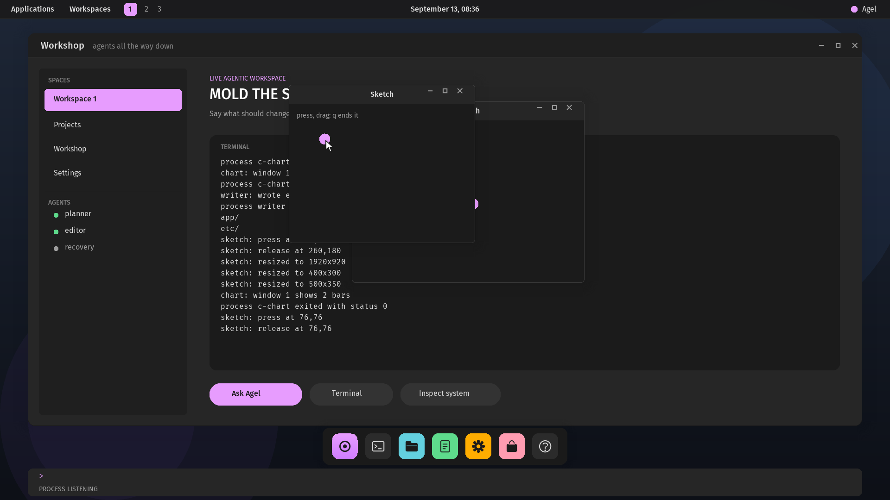

# Agel

**An experimental Lisp and operating system for agents that can revise their own code while they run.**

Agel gives agents isolated state, explicit permissions, and a record of what they did. An agent can propose a source edit, submit it for judgment, and replay recorded cases before activating it. Earlier versions stay available for inspection and revert. The goal is to make live changes explainable and recoverable, from an agent tool down to OS services.

[Quick start](#quick-start) · [What works today](#what-works-today) · [Benchmark results](#runescape-benchmark) · [Roadmap](docs/roadmap.md) · [Releases](https://github.com/michaltakac/agel/releases)



*The native Agel desktop running an isolated graphical program.*

## Quick start

### Run the hosted Lisp

You’ll need Rust and a C compiler. Run this from the repository root.

```sh
cargo run -p agel-cli
```

Try this in the REPL.

```lisp
(def square (fn (x) (* x x)))
(square 12)
```

The result is `144`. Evaluation is transactional. If you enter `(def answer 42) (def broken (/ answer 0))` on one line, the division error leaves both definitions uncommitted. Use `:help` for REPL commands. Pass `-- --image PATH` to Cargo to keep the world across sessions.

### Boot Agel OS

Install QEMU, Clang, and GNU binutils. The x86-64 boot script uses Rust’s `x86_64-unknown-none` target.

```sh
./scripts/run-graphics.sh
```

Open the **Workshop** from the desktop. Use `--web` for the browser-based console, or run `./scripts/run-qemu.sh` for the serial workshop. [Desktop guide](docs/native-graphics.md) · [Serial workshop](docs/native-workshop.md) · [Raspberry Pi](docs/raspberry-pi.md)

## What works today

| Area | What you can inspect or run |
| --- | --- |
| **Language and agents** | Lexical closures, hygienic template macros, modules, and transactional evaluation. Agents have isolated heaps, typed messages, capability-scoped effects, and replayable event history. [Language](docs/language-core.md) · [Agent runtime](docs/agent-runtime.md) |
| **Live changes** | Agel-written repair policies preserve source versions and gate changes with judgment and replay. A native demonstration changes a Lisp form while an existing closure retains its lexical state. [Live evaluator](docs/live-runtime.md) · [Upgrade evidence](docs/evidence-upgrades.md) |
| **Operating system** | A persistent workshop, a graphical desktop, and a POSIX subset run over research kernels for x86-64, AArch64, and RISC-V. The kernel contract also runs on seL4 through Microkit. [Architecture](docs/architecture.md) · [Kernel contract](docs/kernel-contract.md) |
| **Self-hosting** | Agel implements its standard library, a metacircular evaluator, and parts of the native compiler and runtime. The native toolchain can rebuild its reader and compiler from source. Rust still supplies the bootstrap and parts of the runtime and kernels. [Agel in Agel](docs/agel-in-agel.md) · [Native backend](docs/native-backend.md) |

Agel is a research system. The [roadmap](docs/roadmap.md) tracks which paths have been tested and which still need work. See the [threat model](docs/threat-model.md) for the boundaries of the isolation and recovery mechanisms.

## RuneScape benchmark

Old School RuneScape is a workload for testing self-improvement on a live connection. An Agel client runs in the guest and plays on a private OpenRune world. A separate server-save check verifies outcomes, and a protected guest journal records judge attempts and known costs. The game code lives in [`examples/osrs`](examples/osrs). [DOOM](docs/doom.md) remains an earlier desktop example.

A native melee run accepted an edit that reduced encoder callbacks from **73 to 19 in replay**. The edit served zero live packets, and both guests failed the task. The fixed account’s server save nevertheless met the XP goal, which the scorer reports separately. A head-to-head win against Exo remains unverified. [Native score](docs/evidence/v0.3.223-native-melee-score.txt) · [Benchmark report](docs/exo-progress-report.md) · [Private-world setup](docs/osrs-client.md)

## Development

```sh
cargo fmt --all -- --check
cargo test --workspace --locked
cargo clippy --workspace --all-targets -- -D warnings
```

- **Work on the platform** in [`crates/`](crates), [`boot/`](boot), and [`bootstrap/`](bootstrap). Start with the [architecture](docs/architecture.md) and [bootstrap guide](docs/bootstrap.md).
- **Run or extend a workload** in [`examples/`](examples). Its launchers and verification scripts live in [`scripts/`](scripts). Game-specific protocols, policies, and scoring belong with the workloads.
- **Find a native test** in the [CI workflow](.github/workflows/ci.yml), or start with `./scripts/test-native-repl.sh` for the x86-64 workshop.
- **Follow the research** through the [roadmap](docs/roadmap.md), [Exo experiment programme](docs/exo-programme.md), and [release history](https://github.com/michaltakac/agel/releases). The latest release verifies [the staged raw materials for a two-batch adamant production run](docs/release-v0.3.229.md).
